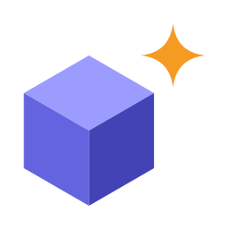

<div align="center">



# Blockbench MCP

**Model, texture, rig and animate in Blockbench by talking to an AI assistant.**

An MCP server and a companion Blockbench plugin. Describe what you want; the assistant builds the
model, unwraps and paints it, adds bones and animations, checks its own work with screenshots and
exports to any format Blockbench supports. Every step lands in Blockbench's undo history, so
`Ctrl+Z` takes back anything you don't like.

[](https://github.com/RenasDemirbas/BlockBenchMCP/releases/latest)
[](LICENSE)


**[Install](#install)** · **[What you get](#what-you-get)** · **[Workflows](#workflows)** ·
**[Tools](#tools)** · **[Changelog](CHANGELOG.md)**

</div>

---

## What you get

- **Minecraft-style models end to end.** Bone trees, cubes with mirrored twins, fur and leaf cards,
  texture templates, painting by face or by whole limb, keyframes with Molang, 20 motion presets.
  Bedrock, Java, OptiFine and glTF out.
- **Low-poly, hand-painted characters.** Limbs from cross-sections, extrude / inset / bevel, taper
  and bend with proportional falloff, island unwrapping, light / AO / edge baking into a pixel-art
  ramp, palette locking.
- **Skinned meshes.** Armatures from head and tail points, automatic vertex weights that repair
  what Blockbench's own solver gets wrong, weight smoothing at the joints, IK on armature bones, glTF
  export with the skin.
- **Materials.** Height, normal and MER maps from a colour texture, from built-in presets or the
  ones you saved in Blockbench. Soft seams across face edges and UV cuts.
- **It checks its own work.** Screenshots and multi-view captures (also in weight-colour and
  material view), silhouette comparison against your reference picture, intersection, ground-contact
  and detached-part checks during animation.
- **Pixel art for 2D games.** Real pixel-art renders, not downscaled screenshots: 4 / 8 / 16
  directions, sprite sheets with Aseprite JSON and a stable feet pivot.
- **Extensible.** Other Blockbench plugins can add their own tools; the assistant sees them at once.

## Safe by design

- **Local only.** The bridge listens on `127.0.0.1`. Other devices on the network can't reach it,
  and since 1.6.1 neither can websites open in your browser.
- **Undo anything.** Every tool writes to Blockbench's undo history.
- **No freezes.** `eval_code` refuses Node modules that would open Blockbench's blocking permission
  dialog.
- **Nothing phones home.** No telemetry, no update checks, no background service besides the server
  your MCP client starts.

> [!IMPORTANT]
> On 1.6.0 or older, any website open in your browser could reach the bridge while Blockbench and
> the server were running. Update. Details under [Security](#security).

## Install

**1. Get the two files.** Download `blockbench_mcp.js` and `mcp-server.js` from the
[latest release](https://github.com/RenasDemirbas/BlockBenchMCP/releases/latest) (also as a zip)
and put them in a folder that stays put. The server is bundled; no `npm install` needed.

**2. Load the plugin.** In Blockbench: **File → Plugins → ⋮ → Load Plugin from File**, pick
`blockbench_mcp.js`, accept the prompt.

**3. Register the server** with your MCP client.

```bash
# Claude Code
claude mcp add --scope user blockbench -- node /path/to/mcp-server.js
```

```jsonc
// Claude Desktop: "mcpServers" in %APPDATA%\Claude\claude_desktop_config.json, then restart it fully
"blockbench": {
  "command": "node",
  "args": ["C:\\path\\to\\mcp-server.js"],
  "env": { "BB_BRIDGE_PORT": "8188" }
}
```

**4. Check it.** With Blockbench open, ask for *"the Blockbench status"*. `get_status` should report a
connected Blockbench and plugin version.

It needs Blockbench 5.2 or newer (5.1.4 works, minus the 5.2 tools) and Node.js 18 or newer.
Several clients can run at once: the first server becomes the bridge, the others relay through it.

<details>
<summary><b>Build from source</b></summary>

```bash
git clone https://github.com/RenasDemirbas/BlockBenchMCP.git
cd BlockBenchMCP
npm install
npm run build           # dist/blockbench_mcp.js + dist/mcp-server.js (reads node_modules)
npm run build:release   # single-file server with dependencies bundled
```

</details>

<details>
<summary><b>Updating</b></summary>

1. Overwrite both files with the new ones (or `git pull && npm run build`).
2. Restart Blockbench, then restart your MCP client: a running server keeps the old version.

`plugin_version` in `get_status` shows what is loaded.

</details>

## Try it

> Make a wolf in the Bedrock entity format. Build only the skeleton and the shape in grey cubes
> first and show me three views. If I like it, texture it and add a walk cycle.

> Build a low-poly knight in the free format from `C:/refs/knight.png`. Compare the silhouette as you
> go, unwrap at 48 px per unit, paint flat colours and bake the shading into its own layer.

> Rig the tentacle mesh with an armature of five bones, fix the weights at the joints and make it
> wave. Export it as GLB.

> Render the slime as an 8-direction isometric sprite sheet at 64 px with the pico8 palette.

## Workflows

Building step by step beats asking for everything at once: a screenshot after each step costs less
than fixing everything at the end.

<details>
<summary><b>Cube model (Minecraft-style entity)</b></summary>

1. **Project and skeleton.** `create_project`, then the bone tree with `add_groups`
   (`body > head`, `body > leg_fl` …). Animations apply to these groups.
2. **Geometry.** `add_cubes` inside the groups; `mirror: true` for symmetric limbs; `add_planes`
   for fur and leaves.
3. **Check.** `capture_multi_view` from the front, side and top. Fix proportions now; changing
   geometry after painting breaks the UVs.
4. **Texture.** `generate_texture_template` first, then `paint_texture` / `paint_faces`. Without
   the template many faces share one UV area and painting one repaints the others.
5. **Animation.** `create_animation`, `set_keyframes`, `mirror_keyframes` for left-right pairs.
   `validate_model` catches intersecting and detached parts during the animation;
   `query_geometry` checks that the feet touch the ground.
6. **Export.** `project_file` `export` / `export_animations`, or `pixel_art` `export_sheet` for 2D.

</details>

<details>
<summary><b>Low-poly, hand-painted character</b></summary>

1. **Reference.** `compare_reference` reports silhouette similarity (IoU) and, per height band,
   how much wider or narrower the model is, in units.
2. **Blockout.** `add_loft` for arms, legs, trousers and torso: give each ring's centre and size and
   get a tapering, bending limb. A cylinder (`add_mesh_primitive`) for a hat brim; a plane +
   `edit_mesh` solidify for a cape.
3. **Shaping.** `transform_mesh` taper / bend / twist (add `falloff` for soft edits), `edit_mesh`
   extrude / inset / loop cut / bevel. Steps chain with `select: "previous"`.
4. **UV.** `unwrap_mesh {pixel_density: 32-64, density_scale: {"head": 2}}`. Limbs unwrap as single
   strips; existing paint is carried over.
5. **Flat colours.** `palette {action: "ramp"}`, then `paint_faces`; on meshes `faces: ["up"]` picks
   the upward-facing faces. `project_reference` can project the picture as a starting point.
6. **Soften and bake.** `blend_seams` evens out colour breaks between parts;
   `bake_texture {layer: "shading"}` paints light, AO and edges as hue-shifted pixel-art steps.
7. **Clean up.** `palette {action: "quantize"}` locks stray colours to the palette.
8. **Record.** `record_build` `start` / `stop` turns the build into a part-by-part GIF.

The whole pipeline runs in `scripts/examples/build-gunslinger.mjs`, which builds a four-armed,
gas-masked gunslinger in a new tab:

```bash
OUT=C:/output/folder node scripts/examples/build-gunslinger.mjs
```

</details>

<details>
<summary><b>Skinned mesh (armature)</b></summary>

1. Build one continuous mesh (`add_loft`, `edit_mesh`), in the `free` format.
2. `add_armature {bones: [{name, head, tail, parent}], meshes: ["body"]}` builds the skeleton and
   skins the mesh in one call.
3. `capture_screenshot {view_mode: "weighted_bone_colors"}` shows which bone owns which vertex.
4. `vertex_weights` `smooth` (with `near: {bone, distance}`) softens creasing joints; `set` paints a
   weight onto a selection; `inspect` lists vertices that follow no bone.
5. Pose with `set_keyframes` on the bone names, or drive a chain with `add_ik_controllers`.
6. `project_file` `export` `glb` with `{armature: true}`.

Groups stay the right choice for blocky Minecraft rigs, where parts move rigidly.

</details>

<details>
<summary><b>Coordinate conventions</b></summary>

- 1 unit = 1/16 block. Y is up; the ground is y = 0.
- +X is east, -Z is north. Entities face north (-Z); the `north` camera preset shows the front.
- Rotations are degrees, order ZYX. +X swings a hanging limb forward.

</details>

## Tools

74 tools. Each one's parameters are described in its schema, which the assistant reads on its own.

| Area | Tools |
|---|---|
| Project | `get_status`, `blockbench_window`, `list_formats`, `create_project`, `get_project_info`, `set_project_settings`, `project_file` (open, save, export, export_animations, import, get_json, switch_tab, close) |
| Geometry | `add_groups`, `add_cubes`, `add_meshes`, `add_mesh_primitive`, `add_loft`, `edit_mesh`, `transform_mesh`, `add_planes`, `add_locators`, `add_bounding_boxes`, `list_outline`, `get_element`, `update_elements`, `delete_elements`, `duplicate_elements`, `mirror_elements`, `select_elements` |
| Texture | `create_texture`, `generate_texture_template`, `list_textures`, `get_texture`, `import_texture`, `apply_texture`, `paint_texture`, `paint_faces`, `bake_texture`, `blend_seams`, `generate_pbr_map`, `palette`, `texture_layers`, `resize_texture`, `set_texture_resolution`, `delete_texture` |
| UV | `unwrap_mesh`, `uv` (inspect, set_cube, set_mesh, auto) |
| Animation | `create_animation`, `list_animations`, `get_animation`, `update_animation`, `delete_animation`, `set_keyframes`, `edit_keyframes`, `mirror_keyframes`, `add_effect_keyframes`, `apply_animation_preset`, `variable_placeholders`, `preview_animation`, `render_animation` |
| Rigging | `add_ik_controllers`, `bake_ik_animation`, `add_armature`, `vertex_weights` (auto, set, smooth, normalize, clear, inspect) |
| Checking | `validate_model`, `query_geometry`, `capture_screenshot`, `capture_multi_view`, `record_build` |
| Reference | `compare_reference`, `project_reference`, `preview_models`, `reference_images` |
| Pixel art | `pixel_art` (render, export_sheet, presets) |
| Display | `display_transforms` (get, set) |
| Other | `run_action`, `eval_code`, `undo`, `redo` |

<details>
<summary><b>What Blockbench 5.2 unlocks</b></summary>

Texture layer groups, IK with poles, movable reference models, reference images as 3D panels, Java
26.3 `shade_direction_override`, the cushion skin template, Molang `variable_placeholders`, bounding
boxes in the generic format, the `embedded` and `on_shelf` display slots and glTF `merge_armature`.
Built on top of 5.2:

- Armatures and vertex weights (`add_armature`, `vertex_weights`); IK over armature bones.
- `transform_mesh` `falloff`: proportional editing, in a straight line or along the mesh edges.
- `generate_pbr_map`: height, normal and MER maps with the dialog's math and presets.
- `blend_seams`: what the screen-space brush is for, done in world space.
- `capture_screenshot` `view_mode`: weight colours, material, normals and the other view modes.
- Video reference images: seek, play, pause, mute and volume.
- `edit_keyframes` `relative_to_playhead`; `project_file` `resolve_parents` for Java child models;
  `molang` and `pbr` flags in `list_formats`.

The `features` field of `get_status` shows which of these your Blockbench has.

</details>

<details>
<summary><b>Tips</b></summary>

**Texturing**

- `target: {element: "leg_fl", faces: "all"}` paints every cube in a group at once; `"*"` is the
  whole model.
- Give gradients `space: "world"`, otherwise they restart on every cube and multi-part limbs look
  banded. `stops` makes multi-stop gradients.
- Shadows on their own `layer` set to `multiply` stay easy to tune.
- `jagged_edge` for fur silhouettes, `strands` for fur grain.
- Looks right as an image but wrong on the model? Run `uv` `inspect` first. `get_texture` with an
  element and face crops and enlarges that face.
- Washed out or covered in a grid? Check Blockbench's `brightness` and `pixel_grid` settings before
  repainting.

**Animation**

- Keyframe values can be Molang: `"math.sin(query.anim_time*360)*15"`.
- Times snap to the animation's FPS grid (24 by default); `snap: false` keeps exact times.
  `edit_keyframes` retimes and deletes, also everything before or after the playhead.
- With a rest rotation on a bone, keyframes add to it; they are not absolute angles.
- `apply_animation_preset` for quick motion: float, flap, swing, sway, shake, jump, flicker …
- Bake IK (`bake_ik_animation`) before exporting animations to Bedrock or Java.

**Pixel art**

- Views: `side`, `front`, `back`, `top`, `three_quarter`, `top_down`, `isometric` (2:1),
  `true_isometric`, or free `yaw` / `pitch`. `directions: 8` for a rotation set;
  `mirror_directions: true` halves the work on symmetric models.
- Styles: `outlined` (default), `clean`, `minecraft`, `flat`. Palettes: the model's own colours, or
  `pico8`, `sweetie16`, `endesga32`, `db32`, or your own list, with optional Bayer dithering.
- `export_sheet` writes one PNG plus Aseprite JSON; scale and pivot are fixed once, so frames don't
  drift. Ask for `pixel_art` `presets` to see every option.

**File paths.** Saving and exporting need absolute paths. `get_status` returns the home, desktop
and temp folders and `get_project_info` the last folder used per file type; the assistant builds
paths from them.

</details>

## How it works

```
MCP client ──stdio──► mcp-server.js ◄──ws://127.0.0.1:8188── blockbench_mcp.js (in Blockbench)
```

The WebSocket server runs on the MCP side and the plugin connects to it, so Blockbench never asks
for network permissions. If Blockbench closes, the server keeps running and the plugin reconnects
within seconds when it reopens. Timers are kept running while the window is minimized, so long
operations don't stall in the background.

The port is 8188. To change it, set `BB_BRIDGE_PORT` and **Settings → General → MCP Bridge Port**
to the same value.

<details>
<summary><b>Headless mode</b></summary>

With `BB_HEADLESS=1` in the server's `env`, Blockbench doesn't need to be open: when a tool needs it,
the server starts it with the window hidden, waits for the plugin (about 5 s) and runs the tool.
Screenshots and renders draw offscreen.

```json
"env": { "BB_BRIDGE_PORT": "8188", "BB_HEADLESS": "1" }
```

- `blockbench_window` shows and hides the window, with or without headless mode.
- An already running Blockbench is used as it is.
- `BB_EXECUTABLE` points to a non-default install; `BB_LAUNCH_TIMEOUT_MS` (90000) caps the wait.
- Hiding the window is Windows-only for now. On macOS and Linux Blockbench starts visibly; on a
  Linux server without a display, point `BB_EXECUTABLE` at a script that runs it under `xvfb-run`.

</details>

<details>
<summary><b>Adding tools from another plugin</b></summary>

Another Blockbench plugin registers tools through `window.BlockbenchMCP`; the assistant sees them
next to the built-in ones with no server restart. Listen for `blockbench_mcp_ready` so the tool is
added whichever plugin loads first, and again after the bridge reloads.

```js
let tool;
function addTools() {
  tool = BlockbenchMCP.registerTool({
    name: 'count_cubes',
    title: 'Count cubes',
    description: 'Count the cubes in the open project, optionally only those whose name contains a filter.',
    inputSchema: { type: 'object', properties: { filter: { type: 'string' } } }, // JSON Schema
    annotations: { readOnlyHint: true },
  }, ({ filter }) => ({ count: Cube.all.filter((c) => !filter || c.name.includes(filter)).length }));
}

Plugin.register('my_plugin', {
  onload() {
    if (window.BlockbenchMCP) addTools();
    window.addEventListener('blockbench_mcp_ready', addTools);
  },
  onunload() {
    tool?.delete();
    window.removeEventListener('blockbench_mcp_ready', addTools);
  },
});
```

- `name`: 1–64 characters of `A-Z a-z 0-9 _ - .`; names already taken are refused.
- `description` is required: it is all the assistant reads to decide when to call the tool.
- `inputSchema` is optional and must be `type: "object"`. Arguments are not validated against it;
  the handler should check them.
- The handler may be `async`. A string comes back as text, anything else as JSON; put PNG data URLs
  in `__image` / `__images` to return images. A thrown error becomes the tool's error. Calls time out
  after 120 s. `registerTool` returns an object whose `delete()` removes the tool.

</details>

## Security

- **The bridge listens only on this computer** (`127.0.0.1`).
- **Websites can't connect** (since 1.6.1). Only connections without an Origin header (Node) and the
  Blockbench window (`file://`) pass the handshake. Programs on your computer can still connect;
  they already run with your permissions.
- **`eval_code` can't freeze Blockbench.** Node modules that open a permission dialog (`fs`,
  `child_process` …) are refused before the code runs; `allow_native_modules: true` opts out, with
  the Blockbench window in the foreground.
- **A shared `.bbmodel` may contain local paths.** Blockbench saves the full path of animation files,
  which can include your username.

## Development

```bash
npm run build && npm run typecheck
node scripts/call-tool.mjs eval_code '{"code":"setTimeout(() => Plugins.devReload(), 300); \"ok\"","undo":false}'   # reload the plugin
node scripts/call-tool.mjs pixel_art '{"action":"render","view":"isometric","size":64}' --images e2e-output/tmp  # call any tool
```

A running MCP client fixes its tool list when its server starts; `call-tool.mjs` spawns a fresh
server, so new tools and parameters can be tried without restarting the client.

The source is split by layer: `server/src/tools` holds the tool schemas, `plugin/src/handlers` the
Blockbench side of each command (reads, writes, undo), and `plugin/src/rig`, `mesh` and `texturing`
the pure math behind skinning, deformers, PBR maps and seam blending.

<details>
<summary><b>Tests</b></summary>

Run any of them with `node scripts/<name>`.

| Script | What it tests | Needs |
|---|---|---|
| `smoke-test.mjs` | MCP protocol and bridge, with a fake plugin | Nothing |
| `verify-bridge-origin.mjs` | The bridge refuses connections from websites | Nothing |
| `verify-plugin-api.mjs` | Tools added by other plugins: listing, calls, relays, removal, re-adding after a reload (moves the plugin to port 8191 and back) | Open Blockbench |
| `e2e-test.mjs` | Full modeling scenario | Open Blockbench |
| `e2e-pro-test.mjs` | Validation, queries, mirroring, painting | Open Blockbench |
| `verify-paint-ops.mjs` | Paint operations | Open Blockbench |
| `verify-detached.mjs` | Detached parts at rest and during animation | Open Blockbench |
| `verify-field-fixes.mjs` | 1.3 fixes | An open project |
| `verify-v52-features.mjs` | Blockbench 5.2 features | Blockbench 5.2 |
| `verify-v52-additions.mjs` | Armatures and weights, armature IK, falloff, PBR maps, seam blending, playhead selection, molang flag, Java parent chains, video references, view modes | Blockbench 5.2, ffmpeg for the video check |
| `verify-pixel-art.mjs` | Pixel-art output (PNG and JSON) | Open Blockbench |
| `verify-lowpoly-tools.mjs` | Mesh painting, unwrap, edit / loft / transform, bake, palette, reference, recording; pick sections with `… paint,bake` | Open Blockbench, `REF_DIR` for the reference tests |
| `verify-headless.mjs` | Headless launch, hidden-window tools and screenshots, `blockbench_window` | Windows, Blockbench closed |
| `verify-hidden-window-timers.mjs` | Timers while the window is in the background | Minimized Blockbench |

</details>

## Troubleshooting

- **"Blockbench is not connected".** Is Blockbench running, is the plugin enabled under
  **File → Plugins**, and is the port the same on both sides (8188)?
- **Updated but nothing changed.** Restart the MCP client; the running server keeps the old file.
- **Long operations time out in the background.** `timers.unthrottled` in `get_status` should be
  `true`; if not, bring Blockbench to the front.
- **Logs.** Claude Desktop: `%APPDATA%\Claude\logs\mcp-server-blockbench.log`. Blockbench:
  `Ctrl+Shift+I` → Console → `[MCP]` lines.

## License

Copyright (C) 2026 Renas Demirbas

Blockbench MCP is free software: you can redistribute it and/or modify it under the terms of the
[GNU General Public License](LICENSE) as published by the Free Software Foundation, either version 3
of the License, or (at your option) any later version. It is distributed in the hope that it will be
useful, but without any warranty; see the license for details.
